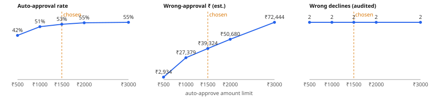

# Project 1: Refund and claim decision system, results

_Synthetic data, same structure as production. Rule version **v1**, test window 03 Aug – 01 Nov 2026 (13 weeks, IST). Generated by `report.py`; edit the assumptions at the bottom and rerun._

## Results

| Measure | Value |
|---|---|
| Claims in the test window | 4,283 (3,880 treated, 403 holdout) |
| Auto-decision rate at ₹1,500 limit | 55% (2,073 approved, 49 declined) |
| Wrong approvals | 15 in audit sample (2.5% of audited approvals), ₹39,324 est. |
| Wrong declines | 2 in audit sample (10% of audited declines) |
| Agent minutes saved | 25,679 (33 agent-hours a week) |
| Net weekly saving versus holdout | **₹11,547** |
| Claims caught only by cluster view | 5 would be auto-approved per account; 2 of them are audited not genuine |

## Threshold sweep (what Finance decides on)

Same engine, same claims, only the amount limit changes. Holdout excluded.

| Limit | Auto-approved | Approval rate | Wrong approvals (audited) | Wrong-approval ₹ (est.) | Wrong declines | Agent min saved | Net (window) | Net / week |
|---|---|---|---|---|---|---|---|---|
| ₹500 | 1,646 | 42% | 2 | ₹2,934 | 2 | 20,469 | ₹2.1L | ₹16,536 |
| ₹1,000 | 1,982 | 51% | 12 | ₹27,379 | 2 | 24,542 | ₹2.1L | ₹16,535 |
| **₹1,500** | 2,073 | 53% | 15 | ₹39,324 | 2 | 25,679 | ₹2.1L | ₹16,141 |
| ₹2,000 | 2,119 | 55% | 17 | ₹50,680 | 2 | 26,250 | ₹2.0L | ₹15,531 |
| ₹3,000 | 2,145 | 55% | 20 | ₹72,444 | 2 | 26,587 | ₹1.8L | ₹14,013 |

**Chosen: ₹1,500** (highest net in the sweep: ₹500). Dropping to ₹1,000 changes net by +₹394 a week but sends 91 more claims (19 agent-hours) to the queue; 26 of the 29 audited ones are genuine customers who would wait longer. Raising it to ₹2,000 auto-approves 46 more claims, changes net by −₹610 a week and adds ₹11,355 of wrong approvals over the window (2 of 13 audited claims in that band not genuine). Finance owns this number.

## Holdout versus treated (whole window)

Holdout = `md5(claim_id) % 100 < 10`. Holdout claims skip the rules and go to an agent as today.

| Per claim | Treated | Holdout |
|---|---|---|
| Claims | 3,880 | 403 |
| Agent handling minutes | 5.4 | 12.0 |
| Approval rate | 91% | 89% |
| Refund ₹ | 599 | 599 |
| Repeat claim from the cluster within 30 days | 14% | 14% |
| Cost (refund + handling) | 632 | 671 |
| CSAT | not in synthetic data | not in synthetic data |

- Net weekly saving versus holdout = (holdout cost − treated cost) × treated claims ÷ 13 weeks = **₹11,547**.
- Contamination: 31% of holdout claims share a customer cluster with a treated claim. That is large: a customer who gets a fast auto-approval on one claim and a slow agent on the next is in both arms. For v2, assign holdout by `md5(cluster_id)` instead of claim_id.
- Sizing: with ~124 holdout and ~1,194 treated claims per 4 weeks, the smallest approval-rate change we can detect is about **8% points** (80% power, 5% two-sided). Do not promise a smaller effect.
- Repeat-claim rate is the same in both arms here because the synthetic data plants no behaviour change; with real data this is the metric that shows whether auto-declines deter repeat abuse.

## Weekly report, week of 26 Oct

| Item | This week | Last week (19 Oct) | Assumed at approval |
|---|---|---|---|
| Claims received | 227 (19 holdout) | 315 (26 holdout) | — |
| Auto-approved / auto-declined / to agent | 128 / 3 / 77 | 157 / 3 / 129 | 50% auto-decided |
| Wrong approvals (count, ₹) | 0 audited, ₹0 est. | 2 audited, ₹5,574 est. | rate ≤ 5% |
| Wrong declines (count) | 0 audited | 0 audited | rate ≤ 10% |
| Agent minutes saved | 1,542 | 1,905 | — |
| Net saving (₹) | ₹9,252 | ₹16,782 | ₹5,000 |
| Holdout vs treated | handling 12.0 vs 5.4 min/claim, repeat 14% vs 14% (window to date) | | |

**Drift flags and actions**

- Auto-approve share moved +7.3 pts vs 4-week average. Check rule change / data / behaviour.
- 8 claim(s) with an unmapped reason value went to agents. Map it or confirm it stays manual.
- Decision log gaps: 0 (engine refuses to finish with any).

Monday review: open every audited wrong approval and wrong decline from the week, read its reason codes, and write down which rule caused it.

## Assumptions (edit in `report.py`)

| Assumption | Value |
|---|---|
| Agent cost per minute | ₹6 |
| Minutes to reverse a wrong decline | 15 |
| Goodwill credit per wrong decline | ₹200 |
| Lost repeat margin per wrong decline | ₹350 |
| Audit sample rate (from data) | 30% |

Definitions: wrong approval = auto-approved and audit says not genuine (cost = claim amount). Wrong decline = auto-declined and audit says genuine (cost = fix time + goodwill + lost margin). Saved = agent minutes saved × cost per minute + amount of correctly declined claims. Net = saved − wrong approvals − wrong declines.
